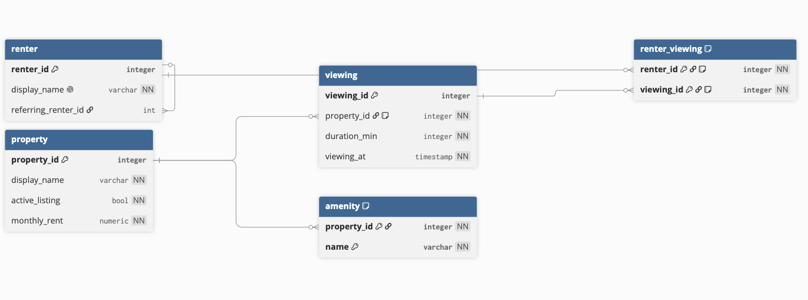

# ex603-rental-marketplace-database

## description
Repository for the rental marketplace database and related homeworks

## domain
This platform is a rental marketplace database that tracks home viewings for potential renters. The schema breaks down into 5 main entity types: 
Actor - the person viewing the home
Producer - the property being viewed
Event - the viewing event
Catalog - the amenities available for the home
Junction - the join of renters and viewings

The database is defined to answer the following questions:

- how many properties are available for rent?
- how many listings are available in a renters price range?
- what is the average duration of a viewing event?

Embed the ERD image.

## Schema

The schema is defined in `schema/schema.sql`.

### Tables

| Table | Purpose | Primary key |
|---|---|---|
| `renter` | Stores renters and their unique display names. | `renter_id` |
| `property` | Stores properties, listing status, and listing prices. | `property_id` |
| `viewing` | Stores scheduled viewing times and durations for a property. | `viewing_id` |
| `renter_viewing` | Records which renters are registered for each viewing. | (`renter_id`, `viewing_id`) |
| `amenity` | Stores the amenities associated with a property. | (`property_id`, `name`) |

### Design Decisions

1. the amenities was originally implemented with a join table on property such that the amenities were an entity type on their own. this has been collapsed into a single `amenity` table with a multi-value pattern from property. 
2. the `viewing` table was was originally implemented as the join table between `property` and `renter`. viewing was changed to be a standalone entity. we use a join table on between the viewing and renter to support multiple renters at a viewing. the property is now one to many with a viewing.
3. the `renter` table adds a self referencing column to support referrals between renters.
4. `viewing.ending_at` is a derived attribute based on `viewing.starting_at` and `viewing.duration_min`.

## Unit 4: Viewing performance

Unit 4 uses the provided dataset in [queries/unit3/rental.sql](queries/unit3/rental.sql),
A producer is a property, an actor is a renter, the metric is
`duration_min`, and a failure is a recorded `Renter no show`. Region means
the property's `city`.

### Query catalogue

| File / query | Business question |
|---|---|
| [q4_1.sql](queries/unit4/q4_1.sql) — 4.1A | How much viewing activity occurred, what are the duration statistics, how many renters participated, and what is the platform failure rate? |
| q4_1.sql — 4.1B | Which properties have the most events, and how do average duration and failure rate vary? |
| q4_1.sql — 4.1C | Which properties have at least 15 viewings for an initial volume comparison? |
| q4_1.sql — 4.1D | How do volume, duration, and failure rate vary by property region and viewing status together? |
| [q4_2.sql](queries/unit4/q4_2.sql) — 4.2A | How many viewings and renter no-shows does each property have, counted together? |
| q4_2.sql — 4.2B | What are the regional subtotals and platform grand total, without detail rows? |
| q4_2.sql — 4.2C | What is the weighted failure baseline among properties with at least 15 viewings? |
